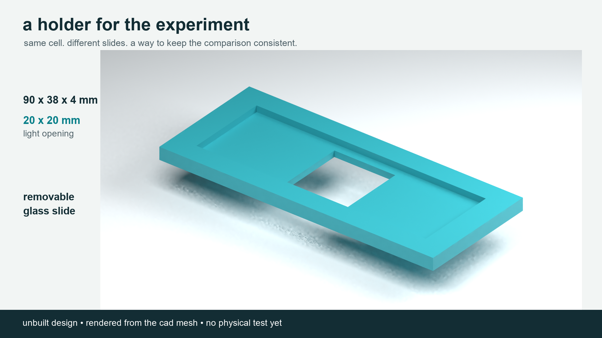

# trying a silicon quantum-dot film on a solar cell

the idea is to put a thin film above a silicon solar cell, let it absorb some shorter-wavelength light, and see whether the light it gives back actually helps the cell.

the first thing that needed fixing was the simulation. the old write-up claimed a gain, but the clean rerun showed a loss. with the corrected solar spectrum, the model gives **-1.39 `mA/cm2`**. that's a simulation with assumed inputs. it isn't a measurement of a real film.

right now, this repo has the corrected model, a build plan, and a small holder designed to make the comparisons easier. the holder hasn't been printed, and the experiment hasn't been run.



## what the holder does

it holds a coated glass slide above a separately mounted cell. the plan is to swap slides while leaving the cell and its wires alone. that makes it easier to compare plain glass, plain polymer, and polymer with quantum dots.

there's a 20 x 20 mm opening in the middle, a pocket for a 75 x 25 mm slide, and four separate spacers. the holder doesn't make electricity. it just helps keep the test setup consistent.

## where to start

- [what went wrong in the original model](docs/audit.md)
- [what to get](docs/bom.md) and [how to run the experiment](docs/protocol.md)
- [the holder files and printing notes](cad/README.md)
- [renders, the animation, and what each part does](media/visual-guide.md)
- [the video outline](media/video-plan.md) and [draft voiceover](media/voiceover.md)
- [a blank lab record](templates/lab-record.md)

## run the model

you'll need python 3.10 or later and numpy 2.x. run these from this folder:

```sh
python -m pip install -r requirements.txt
python analysis/model.py
python -m unittest discover -s tests
python cad/export_mesh.py
```

the model writes its numbers to `data/processed/results.json` and its sweep to `data/processed/sweep.csv`. it also makes `analysis/corrected-sweep.svg`. these are all simulation outputs. the spectrum's source and file hash are recorded too.

the five model tests passed. the exported meshes also passed the edge, winding, and volume checks. those checks don't tell us whether a print will fit the real slide; that still needs a test print.

## what's in here

| folder | what's there |
|---|---|
| `analysis/` | the corrected model and plot |
| `cad/` | editable design, printable meshes, and fit notes |
| `data/processed/` | reference spectrum and model results |
| `data/raw/` | a place for real readings once the experiment starts |
| `docs/` | sources, materials, method, and publishing notes |
| `templates/` | blank records for the build and measurements |
| `media/` | editable blender scenes, renders, animation, and video drafts |
| `tests/` | checks on the model's basic behaviour |

the next step is getting a lab and a characterized si-qd material, then making and measuring the films. a negative result is still worth documenting.

[the publishing notes](docs/publishing.md) cover what needs checking before a public release. the prose and narration were drafted with ai help and edited toward my requested style; they aren't records of work i haven't done.
